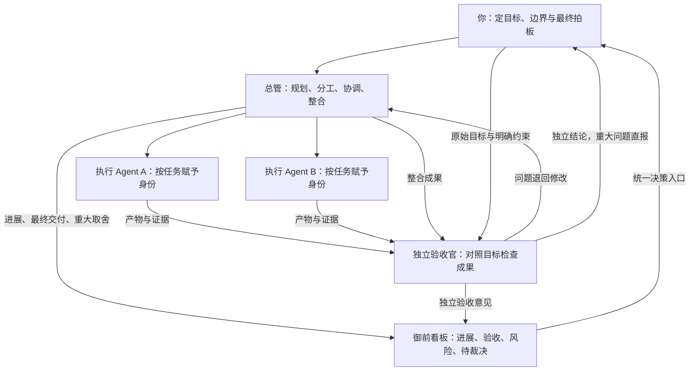

# 多 Agent 班子设计

**用户定目标、最后拍板；总管组织工作；执行组产出成果；验收官独立判断。**

落到模板和工具里的做法见[协作协议](../templates/large/collab/协议.md)和[派活脚本](../tools/dispatch/README.md)。

## 1. 组织结构

| 角色 | 定位 | 职责边界 |
|---|---|---|
| 用户 | 最终决策者 | 提出目标、确定边界、决定重大取舍、批准最终结果；不参与日常调度 |
| 总管 | 固定的组织协调角色 | 拆分任务、安排身份与负责人、协调冲突、整合成果；不能擅改目标或掩盖验收意见 |
| 执行组 | 按需组织的通用 Agent | 承担具体任务并交付成果；每项交付有明确负责人，不自行扩大范围 |
| 验收官（御史） | 独立于执行组的固定角色 | 判断目标是否达成，要求必要返工，可直接向用户报告；不替执行者辩护，也不随意增加要求 |

**固定管理角色，动态执行身份。** 总管与验收官保持稳定分工；执行 Agent 不永久绑定专业岗位，由总管根据任务赋予身份、视角和职责。常用场景可以预设身份，按需调用，具体设置不在本文展开。

## 2. 工作如何流转

**用户下目标 → 总管规划分工 → 执行组完成 → 总管整合 → 验收官独立验收 → 用户拍板。**

- 子任务可先单独验收，最终仍需检查整合成果。
- 验收不通过，由总管组织返工，再交验收官复核。
- 日常方法选择、协调和返工由总管处理；改变目标、突破边界或重大取舍才提交用户。
- 执行完成、验收通过、用户批准是三个不同阶段。

## 3. 验收官怎样保持独立

验收官依据**原始目标、明确约束、已批准变更、交付物和必要证据**作判断，不继承执行者的聊天历史、推理叙述和自我评价。

原则是**最小充分上下文**：减少立场影响，同时保留理解和核实成果所需的事实。上下文少并不自动等于客观。

- 不奉承：不能因为用户喜欢或执行者自信，就放宽标准。
- 不挑刺：只把影响目标、正确性、可用性或实质风险的问题作为返工理由；无关细节和个人偏好不阻塞交付。
- 看证据：独立角色也可能判断错误，需要可核实的依据，不能只靠另一个 Agent 表示赞同。

## 4. 全员共同原则：忠于目标，不揣摩意思

**用户想要的结果，是目标；用户随口提出的技术，不一定是要求。**

总管和执行组应区分明确约束、个人偏好与试探性建议，主动比较方案。用户不熟悉技术时，应帮助选择合适路径，而不是为了迎合而默认采用用户提到的办法。

有更合适的方案就说明依据与取舍；明确的硬约束必须遵守。允许提出反对意见、报告失败和不确定性，不为表现顺从而隐藏问题。

用户最终只需看到：**交付成果、独立验收结论、剩余风险、需要拍板的事项。**

## 5. 御前看板：用户的统一决策入口

**用户通过一张看板掌握全局，无需逐个追问 Agent 或翻阅全部对话。** 看板是信息与决策入口，不是新增的管理角色。

| 看板内容 | 用户需要知道什么 |
|---|---|
| 目标与进展 | 当前目标、各任务负责人、所处阶段和已交付成果 |
| 独立验收 | 哪些已通过、哪些需修改、依据和证据入口 |
| 阻塞与风险 | 什么阻止了推进，出现了哪些新问题 |
| 待拍板事项 | 可选方案、代价、总管建议及需要用户决定什么 |
| 下一步与资源 | 接下来由谁做什么，资源使用是否接近约定上限 |

总管负责汇总和更新，验收官的结论与异议独立呈现，不得被总管改写为“已通过”。看板保留查阅原始产物与证据的入口。

**展示结果、变化和需要决策的事项，避免堆积过程消息。** 用户的裁决回到总管继续组织执行；重大问题仍允许验收官直接报告。
